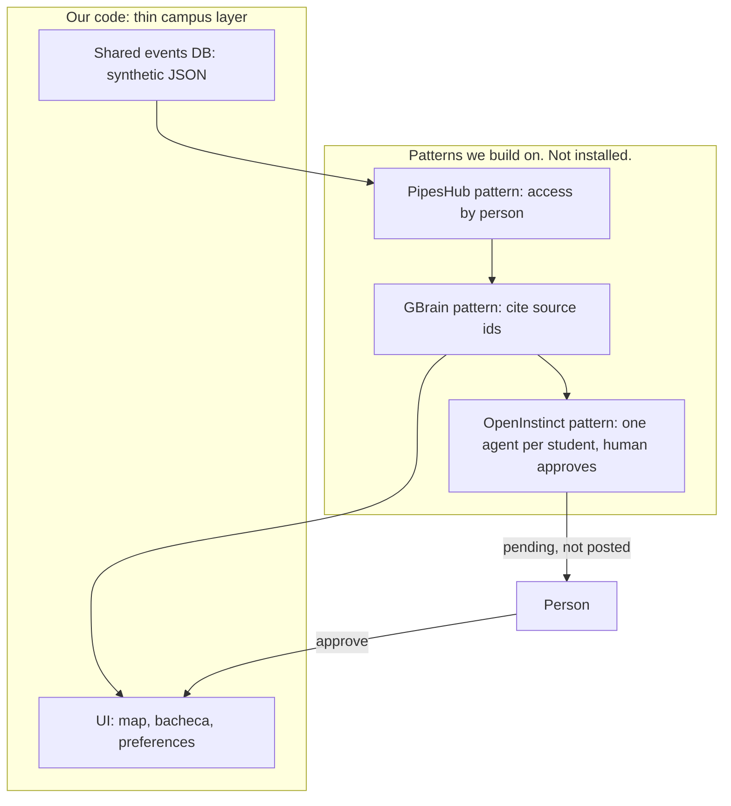

# H-OS

**License: MIT.** This repository is open source under the [MIT License](LICENSE). It is meant to be cloned from GitHub, read, and changed. The Hack Day build does not vendor another agent stack. It takes three open-source patterns and reimplements them in one small Python process.

H-OS is a small operating system for the H-FARM community. The campus is full of the right room for the wrong people: a river cleanup, a lab hour, a pitch breakfast, a film at H-Farmers. Students miss them because nobody is matching the week to a person. H-OS reads preferences and events, proposes one notice, and stops. A human approves. Only then does the notice hang on the bacheca.

Built for H-FARM Hacktoberfest Hack Day, Treviso, 24 October 2026. The screen tonight is the student desk. The thing to hand a judge is this repository.

## Architecture

The running engine is FastAPI plus `app/hos_core.py`. [ARCHITECTURE.md](ARCHITECTURE.md) maps Librarian, Campus Brain, and Agent, and marks each piece REAL, MOCKED, or PLANNED.

The desk path is **Chiedi un evento** → sourced ask → recommendation → **Proponi iscrizione** → **Approva** → agenda. Propose does not register. `app/campus_agent.py` retrieves events, community posts, and `data/docs`, reasons over those hits, and replies with the `source_id`s that survive. Gemini rewrites that reply only with `GEMINI_API_KEY` and only when every id was retrieved. The shape follows smolagents, LlamaIndex, Haystack, and PydanticAI. Those packages are not installed. GBrain, PipesHub, Cognee, Paperclip, and LangGraph are inspiration too.

We build on the [GBrain](https://github.com/garrytan/gbrain) citation pattern and the [PipesHub](https://github.com/pipeshub-ai/pipeshub-ai) access pattern, plus the [OpenInstinct](https://github.com/Merit-Systems/OpenInstinct) pattern of a proactive agent under human control. The map, the bacheca, and the preference list are the thin campus layer we wrote on top.

The product under that layer is a shared events store and one agent per student. The agent knows that student's preferences and suggests where to go. It does not post until a person approves.

**At the table.** We uploaded this MIT repo. It is runnable by someone who was not in Treviso: clone it and run `./run.sh`. GBrain, PipesHub, and OpenInstinct stay on their own GitHub. They are not inside this clone, because their installers would stop a stranger from trying the demo tonight.

### Fork, inspired, or our code

| Piece | Relation | Where it lives |
| --- | --- | --- |
| [garrytan/gbrain](https://github.com/garrytan/gbrain) | **Inspired. Not a fork.** GBrain keeps facts with their sources. We do not vendor it. We keep the rule: every answer names the source ids it used. | Our code: `app/brain.py`, `app/scoring.py` |
| [pipeshub-ai/pipeshub-ai](https://github.com/pipeshub-ai/pipeshub-ai) | **Inspired. Not a fork.** PipesHub is a context layer with access rules. We do not run its connectors or `install.sh`. We keep the rule: records stay records, and a desk reads what that person may see. | Our code: `app/access.py` and the JSON in `data/` |
| [Merit-Systems/OpenInstinct](https://github.com/Merit-Systems/OpenInstinct) | **Inspired. Not a fork.** OpenInstinct can act and still waits for a person before it sends or spends. We do not deploy it, iMessage, or its browser. We keep the rule: one agent per student, one proposal, approval before it goes out. | Our code: `app/agent.py` |
| Campus UI | **Our code.** The thin layer. Signup, the swipe of tags, the map, the bacheca, and the preference roster. | `static/` |
| Local access | **Our code.** The form asks for an institutional email, that email's password, and optional Canvas and Pronote links. The password is checked in the page and is not stored. The desk name is the part before `@` (`alex@` becomes Alex). Likes live in the browser and in `var/hos.sqlite`. The links are not opened. | `app/desk.py`, `POST /desk/profile` |
| Shared events and preferences | **Team dataset, integrated here.** 40 students, 80 events, 12 mock emails, 25 tags. Each file is marked `synthetic: true`. Preference ids such as `pref-001-cinema` are indexes this desk assigns to tags that are already on the student. They are not extra rows in the JSON. | `data/users.json`, `data/events.json`, `data/emails.json`, `data/tags.json` |
| Campus map | **Our code, on Esri World Imagery.** Events name a building and do not carry coordinates. The desk projects those schematic pins around H-FARM at La Serra, Roncade (45.5665, 12.4305). It is not a survey of each building. | `data/places.json`, `static/app.js` |
| Map client | **Vendored, not one of the three.** Leaflet 1.9.4 (BSD-2-Clause) draws the map. Tiles are Esri World Imagery plus the Esri place-label overlay. There is no Google Maps key. | `static/vendor/leaflet/` |
| HTTP API and approval memory | **Our code.** | `app/main.py`. Approvals land in `var/hos.sqlite` on first run and are not committed. |

Nothing in `app/` is copied from those three repositories. The only vendored library is Leaflet, under `static/vendor/leaflet/`, and it is not one of them.

### How the layers sit



`POST /agent/tick` with a `user_id` is that student's agent. It may prepare one notice. It does not post, and it does not speak for the rest of the campus. `POST /agent/approve` is the human control. Until that call, the bacheca has no new notice from the agent.

One process. FastAPI serves the API and the desk. Gemma, if you set a key, may rephrase a sentence and may not add a source.

## Three roles, one campus

| Role | What they are for | Tonight |
| --- | --- | --- |
| **Gestori** | Keep places, hours, and what is open. | Not a login. The team events do not name a host. The loader still accepts `host_role` when a file has it. |
| **Prof** | Put courses, office hours, and readings into circulation. | Not a login. Same as gestori: a field the team file does not carry. |
| **Studenti** | Decide what is worth showing up for, and with whom. | The only desk that is switched on. Forty synthetic students. |

The agent serves students only. The loader refuses a user whose role is not `student`.

## What is real, what is mock

| Real in this process | Mock, and labeled as such |
| --- | --- |
| Jaccard (baseline) and the overlap coefficient in `app/scoring.py`. The older weighted formula remains for a file that actually stores weights | The forty students and the tags they listed. No program, no hometown, no preference weight: those fields are not in the team JSON, and this desk does not add them |
| Source ids on every match, trace, and notice | The eighty events, their building names, and their capacities. The file does not say who is hosting or how many seats are already taken |
| The gate: a tick creates `pending`, and nothing is posted until `POST /agent/approve` | The twelve emails. Addresses are on `.example`. No message is sent |
| SQLite memory of approvals and of the local desk profile (`var/hos.sqlite`). The profile table has no password column | The map pins. See the building table below. The drawing follows the campus layout and is not a survey |
| The signup checks: email contains `@`, password has 8 characters with upper, lower, digit, and symbol, terms are ticked | Canvas and Pronote. The ids are stored only if you type them. Nothing dials those systems. Prenotazioni stays off |
| Optional Gemma “perché”, only if you set `GEMINI_API_KEY`, and only if the note still cites real ids. No key or a failed call uses the Italian template | Nothing about GBrain, PipesHub, or OpenInstinct is mock. Those are real upstream repos. This tree keeps their patterns and does not contain their code. See Architecture. Canvas and Pronote stay mock-only |

Files the loader reads must contain `"synthetic": true`. If that flag is missing, or the file is a bare array, the server refuses to boot. That is deliberate.

## Team dataset

The cohort in `data/` is the team's generator (`data/generate_data.py`, seed `20261024`): 40 students, 80 events, 12 mock emails, 25 tags. The attached inbox file was the email list, not a schema. The field contract is `data/schema.json`.

Preferences are tag names, three to six of them. From 25 tags that is

```text
C(25,3) + C(25,4) + C(25,5) + C(25,6) = 245180
```

theoretical profiles. That number is why a matcher has to be a formula instead of a hand-written card for every student. The repository materializes 40 profiles, not the 245180.

Buildings in the event file, and the pin this desk uses:

| Building in the JSON | Schematic pin |
| --- | --- |
| La Serra | `loc-serra` |
| Building 1 | `loc-college` |
| Building 2 | `loc-lab` |
| Building 3 | `loc-library` |
| Building 4 | `loc-auditorium` |
| Building 5 | `loc-startup` |

Naive timestamps are read as Europe/Rome. After 25 October 2026 that offset is +01. The demo clock stays 24 October 2026, 18:40, +02.

## Run in a few minutes

Python 3.11 or newer.

```bash
./run.sh
```

Then open [http://127.0.0.1:47231](http://127.0.0.1:47231).

`run.sh` creates `.venv`, installs `requirements.txt`, and starts uvicorn on port **47231**. Another port: `PORT=47241 ./run.sh`.

Without the script:

```bash
python3 -m venv .venv
source .venv/bin/activate
pip install -r requirements.txt
uvicorn app.main:app --host 0.0.0.0 --port 47231
```

No API key is required. Copy `.env.example` to `.env` and set `GEMINI_API_KEY` there (or export it) only if you want Gemma to write the short Italian “perché”. The same variable is what you set on DigitalOcean. Do not commit `.env`. Tests pass with the key absent:

```bash
pytest
```

Interactive API docs: [http://127.0.0.1:47231/docs](http://127.0.0.1:47231/docs).

Reset the bacheca with **Azzera approvazioni** in the student column, `POST /demo/reset`, or by deleting `var/hos.sqlite`. The JSON is not touched.

## Demo, 90 seconds

The UI is in Italian. The clock is frozen at Saturday 24 October 2026, 18:40, Treviso time. The first screen is the access sheet, not the map.

1. Email `alex@campus.example`. Password `HackDay!1` (it passes the rule and is then cleared; it is not sent and not stored). The form has no nome or cognome: the desk shows **Alex**, from the mailbox name. Canvas and Pronote are optional links (`https://…`), left empty. Tick **Accetta i termini e servizi**. Press **Entra**.
2. The preference cards are the 25 tags in `data/tags.json`. Drag or scroll down for LIKE, up for DISLIKE. For the short path, press **Profilo demo: cinema, finanza, gaming, programmazione**. That is the same set as cohort student `usr-001`, not a copy of his row.
3. The home is the wireframe. **Mappa** is an Esri satellite view of H-FARM at La Serra, Roncade (45.5665, 12.4305). **Bacheca community** lists the synthetic boards (Student Life, Student Office, Age Fund, Professori, Club, Peer help, Shelf) as labels; **Tutte** shows every post. **Calendario** is an iPhone-style month or week grid: **Mese** / **Settimana**, and a tap on a day lists that day's lesson, evening, or approved agenda item. **Prenotazioni** keeps the Prenota button off. The legend matches the slide: red Mandatory, blue Student events, green Sport / community, yellow Campus event. The top card is **Progetto collaborativo: finanza**, Jaccard **0.50**, a yellow pin on Biblioteca because the event says Building 3. Hover or focus that pin: the card names the event, a short line, the score, and **Apri in bacheca** when it is a match. Under **Perché ti consiglio questo** the bacheca card shows two to four Italian sentences. Without `GEMINI_API_KEY` they are the template from the overlapping tags and the score, and they still name `pref-desk-finanza`, `evt-058`, and `loc-library`. With the key, Gemma writes that note and the desk keeps it only when those ids survive.
4. Press **Tic dell'agente**. The dock fills EVENT, CONTEXT, REASONING, ACTION. The signal is `preference_overlap` (the local profile has no mock email). Status stays `pending`. Nothing is posted yet.
5. Press **Approva**. A card is stamped **APPESO**. The notice says no email was sent. The smiley is the local session: Esci forgets the browser copy. The password was never kept.
6. Press **Coorte** and select Andrea Rossi (`usr-002`). His pin moves to the Auditorium, **Laboratorio pratico: UX-UI**, score 0.60. Alex's local notice does not follow him. The forty cohort students are still the shared events store. `usr-001` still matches `evt-058` if you call the API directly.

Overlap stays in the formula menu. On the local profile the same event scores 1.00 under Overlap, because those two shared tags cover the smaller set.

The same path from a shell:

```bash
curl -s localhost:47231/health
curl -s localhost:47231/tags
curl -s -X POST localhost:47231/desk/profile \
  -H 'content-type: application/json' \
  -d '{"email":"alex@campus.example","likes":["cinema","finanza","gaming","programmazione"],"dislikes":["calcio"]}'
curl -s -X POST localhost:47231/match \
  -H 'content-type: application/json' \
  -d '{"user_id":"usr-desk","limit":3}'
curl -s -X POST localhost:47231/agent/tick \
  -H 'content-type: application/json' \
  -d '{"user_id":"usr-desk"}'
curl -s -X POST localhost:47231/agent/approve \
  -H 'content-type: application/json' \
  -d '{"action_id":"act-REPLACE","decision":"approve"}'
curl -s 'localhost:47231/bacheca?user_id=usr-desk'
```

There is no password field on that POST. A `password` key in the JSON is ignored. Cohort match is unchanged: `"user_id":"usr-001"` still returns `evt-058` at 0.50.

Use the `action.id` from the tick response. `decision` may be `approve` or `dismiss`. A second decision on a finished action returns 409, except repeating the same decision, which is idempotent.

## API

| Method | Path | What it does |
| --- | --- | --- |
| GET | `/health` | Liveness, MIT, student desk, demo clock, counts |
| GET | `/tags` | The 25 topic tags used by the swipe cards |
| POST | `/desk/profile` | Local student. Likes become preferences. No password is stored. Canvas and Pronote are mock strings |
| GET | `/desk/profile` | That local student, or 404 |
| GET | `/users` | The forty synthetic students. The local desk user is not in this list |
| GET | `/users/{id}` | One student. Preference ids are indexes over the tag list |
| POST | `/match` | Body `{"user_id","limit","formula"}`. `formula` is `jaccard` (default) or `overlap`. `weighted` is 422 on this dataset, because the tags have no weights |
| POST | `/agent/tick` | Body `{"user_id","formula"}`, both optional. One proposal for that student's agent, or `idle` |
| POST | `/agent/approve` | Body `{"action_id","decision"}`. The only way onto the bacheca |
| GET | `/agent/actions?user_id=` | Pending, approved, dismissed |
| GET | `/bacheca?user_id=` | Posted notices only. `delivered_externally` is always false |
| GET | `/emails?user_id=` | That student's mock mail only. No `user_id` is a 400: there is no campus-wide inbox |
| GET | `/sources/{id}` | The record behind a citation, with `access.scope` `public` or `personal` |
| POST | `/demo/reset` | Clears approvals |

A match cites the student, the preference indexes that overlapped, the event, the schematic place, a mock email when one links the pair, and any other student who clears the company floor. If a citation id is not in the sentence, the server raises rather than return a quiet claim.

## How a score is made

The team preferences, and the likes from the local signup, are sets of tags, not weights. Dislikes are stored with the local profile and are not subtracted. Two formulas read the like-set. No shared tag means no match. Ties break toward the earlier event. The demo clock and the mock email are cited in the trace. They do not change a Jaccard or overlap number.

Baseline, Jaccard:

```text
score = |preferences ∩ event tags| / |preferences ∪ event tags|
```

Alternate, the overlap coefficient:

```text
score = |preferences ∩ event tags| / min(|preferences|, |event tags|)
```

On this dataset the agent proposes a Jaccard score at or above 0.25, and names another student as company at or above 0.34. For overlap those floors are 0.50 and 0.67. A tick still proposes one person, and it will not propose a pair that already has an outcome.

A third formula, `weighted`, remains for a corpus whose preference rows carry a weight:

```text
score = min(0.99, w / (w + 0.55) + time + mail)
```

`w` is the sum of the weights whose tag is on the event. `time` is +0.06 inside 60 hours, −0.08 if the event has already started, otherwise 0. `mail` is +0.05 when a mock email links that pair. The team JSON has no weights, so `POST /match` with `"formula":"weighted"` returns 422.

A tick stores one trace:

1. **EVENT** — `inbox_hint`, `event_soon`, or `preference_overlap`, with the ids that justify the signal.
2. **CONTEXT** — the student, the overlapping tags, the building, and the schematic pin. A host line appears only when the file has a host.
3. **REASONING** — the score, the threshold, and who else cares. Those other people are not notified by this tick.
4. **ACTION** — a draft for the bacheca, status `pending`, `delivered_externally: false`.

Approve freezes that draft into a notice. Dismiss blocks the pair so the next tick moves on.

## Gemma, if you want it

The card shows **Perché ti consiglio questo** before Approva. That note is two to four short Italian sentences grounded in the student’s likes, the event title, tags, and place, the Jaccard or overlap score, and the Brain source ids.

Set `GEMINI_API_KEY` in the environment or in `.env` (copy `.env.example`; never commit the real file). On DigitalOcean, set the same name as an app environment variable. `GEMMA_MODEL` defaults to `gemma-4-26b-a4b-it` on the Gemini API. Gemma does not choose the ranking and it cannot add a citation chip. A note is kept only when every id it mentions exists in the corpus and the event id plus a preference id from that match are still present.

If the key is missing, the call fails, or the note cites an id that is not in the corpus, the desk uses a deterministic Italian template built from the tags and the score. The demo still reaches Approva. The long cited explanation stays on the match for the audit chips. `narration_mode` in `/health` is `deterministic` until a key is present. `pytest` does not need a key.

## DigitalOcean

One process. It listens on `0.0.0.0` and on `PORT` (local default **47231**, image default **8080**). Approvals live in SQLite. On a platform disk that file is ephemeral unless you attach a volume: a new container starts with an empty bacheca. The JSON corpus is in the image. Do not put `GEMINI_API_KEY` in the image or in git.

Start command, App Platform or a Droplet:

```bash
uvicorn app.main:app --host 0.0.0.0 --port ${PORT:-8080}
```

`./run.sh` is the same command with a venv and default port 47231.

**App Platform.** New app from this repo, Dockerfile (the file at the root). HTTP port is whatever the platform injects as `PORT` (the image falls back to 8080). Environment variables, encrypted: `GEMINI_API_KEY` if you want the live “perché”. Leave it unset and the template is used. Canvas and Pronote are not configured and are not called.

**Droplet.**

```bash
git clone <this-repo> && cd <this-repo>
python3 -m venv .venv && source .venv/bin/activate
pip install -r requirements.txt
cp .env.example .env
# edit .env and set GEMINI_API_KEY, or: export GEMINI_API_KEY=...
PORT=8080 ./run.sh
```

Or with Docker, still without baking the key into the image:

```bash
docker build -t hos .
docker run --rm -p 8080:8080 -e PORT=8080 -e GEMINI_API_KEY="$GEMINI_API_KEY" hos
```

Export `GEMINI_API_KEY` in the shell first. Omit that `-e` to run on the template.

## Growing the corpus

Regenerate the team cohort (it will not match this snapshot if you change the counts):

```bash
python data/generate_data.py --out data/generated --users 40 --events 80 --seed 20261024
HOS_DATA_DIR=data/generated uvicorn app.main:app --port 47231
```

`data/generate.py` is the older weighted cohort, for a file that stores preference weights. It refuses to overwrite `data/`. Either generator marks people synthetic. Emails stay on `.example` and are not sent. Neither script writes the 245180 profiles.

## Visual direction

The three screens follow the paper wireframes: accesso, swipe, then the desk. The signup form asks for an institutional email, the email password, and optional Canvas and Pronote links. Cards are slightly rounded, section titles and the named rail (Bacheca, Mappa, Calendario, Prenotazioni) have a clear border, and a swipe moves the card.

The map is Leaflet on Esri World Imagery, centered on H-FARM at La Serra, Roncade (45.5665, 12.4305), with the Esri boundaries-and-places overlay for labels. Pin positions are the schematic `x`/`y` from `data/places.json`, projected around that point. They are desk placements, not surveyed building corners. Category is not a field in the JSON. The title picks it first: Sessione introduttiva and Laboratorio pratico are red Mandatory, Meetup studenti, Community night, and Sfida a squadre are blue Student events. A sport-like tag on anything else is green Sport / community. The rest are yellow Campus event. A building with more than one category gets one pin per category, nudged apart. Hover, click, or focus opens the Leaflet popup for that pin. **Apri in bacheca** appears when that event is a match. Approva stamps the bacheca card and scrolls it into view.

The calendar opens from **Calendario** or the date stack. **Mese** is a Monday-first month grid. **Settimana** is seven day columns. A tap selects the day and lists lezioni, serate after 18:00, and agenda rows created only after **Approva**. The demo clock stays 24 October 2026.

Colors are sampled from the public [h-farm.com](https://www.h-farm.com) stylesheet on 24 October 2026 (`--primary` `#e2231a`, `--dark` `#202020`, `--gray-100` `#f9f9f9`, `--gray-200` `#f4f2f2`) plus the wireframe cyan rail and campus green. The small required-field red is that primary, darkened so the label stays readable. This is inspired by H-FARM campus visuals. It is not an official brand kit.

Prenotazioni stays a labeled stub. Budget, car sharing, and the map bubble stay off: the bubble does not chat and does not post. The calendar is on. The name on screen is H-OS.

## Inspiration

Same three repositories, same order as Architecture. None of this repo is a fork of them. None of them is imported.

1. [garrytan/gbrain](https://github.com/garrytan/gbrain) — brain and citations. Our code: `app/brain.py`.
2. [pipeshub-ai/pipeshub-ai](https://github.com/pipeshub-ai/pipeshub-ai) — knowledge and access. Our code: `app/access.py`.
3. [Merit-Systems/OpenInstinct](https://github.com/Merit-Systems/OpenInstinct) — one proactive agent per person, human control before it acts. Our code: `app/agent.py`. The campus UI on top is `static/`.

## License

MIT. Copyright (c) 2026 GuDamee. See [LICENSE](LICENSE).
